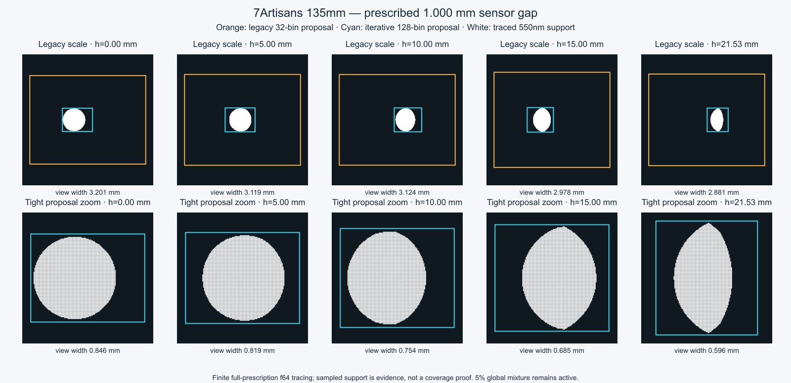

# 迭代出瞳矩形参数实验（2026-10-16）

默认改为 **128 分区**：共享 129 个像高端点，以真实有效种子开始，四边独立扩张、指数步进和二分细化，再对每个区间做中点种子与边缘验证。邻接端点坐标取并集。保留原有 5% 全域混合、完整 PDF、完整物理追迹及失败仍计入尝试数的积分语义。

每条边由 9 点增加至 17 点，安全余量由 guide 尺度的 1.2% / 实测宽度的 0.6% 增加至 2.5% / 1.25%。初版在两个镜头极边缘出现最高约 0.115% 的参考能量落在框外；最终参数在下面有限检查中未再发现遗漏。当前实现为均匀分区加中点验证，尚无自适应二分。

橙色为旧 32 分区，青色为新 128 分区，白色为完整 f64 追迹通过区域。7Artisans 使用资料给定的 1.000 mm 最后顶点至像面间距。

## 测量设置与原始报告

- 代码：`f29e39c` 算法和工具，`146381c` 显式固定资料像面的工具修正。
- 主验证：本机 Safari Technology Preview，Version/27.0，Apple WebGPU adapter，硬件 timestamp 可用。独立标签页始终前台；最终报告 `interrupted=false`、`foreground=true`，无 GPU API 错误或设备丢失。
- 全部镜头为配置 0、最大光圈、36×24 mm 传感器、色散开启、显式 `sensorZMm=lens.sensorZMm`。未把近轴对焦位置称作资料像面。
- GPU：像高为半对角线的 0、49.9%、99.5%，波长 390/550/770 nm，seed 11/29/47，每组 65,536 次尝试；每种算法共 27 组。各算法独立预热，预热不计时。
- CPU：额外使用 0、23.1%、49.9%、77.3%、99.5% 五个像高；192×192 f64 旧版大区域积分和 96×96 全域检查；每组 16,384 次混合采样。
- [Safari 全量 JSON](pupil-iterative-native-safari.json)，[CPU 全量 JSON](pupil-iterative-native-cpu.json)。

## 有效光线比例

下表为 GPU 27 组通过率的算术平均。倍数是通过率提升，不是整帧 FPS 提升。

| 镜头 | 旧 32 | 迭代 32 | 迭代 64 | 迭代 128 | 迭代 256 | 128 / 旧 |
|---|---:|---:|---:|---:|---:|---:|
| 7Artisans 135/1.8 | 2.71% | 24.85% | 35.40% | 45.10% | 52.32% | 16.63× |
| Otus 55/1.4 | 4.04% | 29.37% | 40.43% | 50.04% | 56.83% | 12.38× |
| Canon FL 50/1.8 | 48.41% | 67.44% | 68.60% | 69.24% | 69.28% | 1.43× |
| Canon EF 40/2.8 | 43.22% | 67.46% | 68.69% | 69.44% | 69.50% | 1.61× |
| Sony FE 24/1.4 | 4.44% | 22.54% | 29.76% | 51.22% | 57.31% | 11.54× |

## 预计算与正式追迹耗时

下表为 Safari 首次 table 构建毫秒，不含缓存命中。节点增长仍有成本，128→256 的工作量接近翻倍；共享端点避免的是邻区重复计算。

| 镜头 | 旧 32 | 迭代 32 | 迭代 64 | 迭代 128 | 迭代 256 |
|---|---:|---:|---:|---:|---:|
| 7Artisans 135/1.8 | 174 | 419 | 864 | 1720 | 3386 |
| Otus 55/1.4 | 129 | 350 | 725 | 1451 | 2821 |
| Canon FL 50/1.8 | 37 | 116 | 220 | 437 | 844 |
| Canon EF 40/2.8 | 40 | 134 | 277 | 536 | 1059 |
| Sony FE 24/1.4 | 201 | 537 | 1017 | 2008 | 3959 |

shader/pipeline 首轮建管线为 226 ms，原始轮使用同一 shader 和近轴测试像面；浏览器驱动已有缓存后的最终资料像面轮为 5 ms。这不是全应用启动或所有场景 pipeline 的编译时间，不把最终 5 ms 当作冷编译结论。

以下是每 65,536 次完整镜头追迹的平均毫秒。GPU timestamp 和队列完成/回读墙钟单独保留；部分 Apple timestamp 与墙钟差别较大，因此不据此宣称精确整帧加速。

| 镜头 | 旧 GPU timestamp | 128 GPU timestamp | 旧队列/回读墙钟 | 128 队列/回读墙钟 |
|---|---:|---:|---:|---:|
| 7Artisans 135/1.8 | 9.40 | 10.49 | 11.56 | 12.59 |
| Otus 55/1.4 | 17.91 | 18.31 | 21.67 | 22.11 |
| Canon FL 50/1.8 | 4.00 | 3.84 | 5.37 | 5.26 |
| Canon EF 40/2.8 | 7.72 | 7.84 | 10.70 | 10.56 |
| Sony FE 24/1.4 | 32.31 | 25.08 | 53.37 | 30.74 |

相同尝试数下，大部分镜头的耗时接近，收益主要来自同样预算下通过光线增多、方差降低。Sony 的旧大框还触发大量 f32 求交数值失败，两个分布的工作路径差异更大，不能把其耗时变化外推至其他镜头。

## 正确性与选择

- `npm test`：155/155；`npm run build` 通过。
- Safari 最终生产 BVH/HDR/光谱路径测试通过：白环境平均亮度比 0.994533，离焦点总能量比 0.999056，光斑图像 L1 差 0.291（验收阈值0.4）；中心与二阶矩检查通过。[原始生产集成报告](pupil-iterative-native-engine.json)。该测试使用Otus的1.373 mm补充像面，两个估计器采样预算不同，报告中的时间不用于速度结论。
- 默认 128 在 5 镜头 × 5 像高 × 3 波长的 f64 检查中，发现的有效点均在框内；全域稀疏检查也未发现框外有效点。混合估计相对有限参考积分的最大差约 0.81%，参考网格本身也有离散误差。
- Safari 原/新 GPU 固定样本能量的最大相对差：7Artisans 0.60%、Otus 0.26%、Canon FL 0.071%、Canon EF 0.062%、Sony 0.295%。不同采样分布的有限样本差异不等同于系统偏差。
- Sony 32/64 分区存在数值不确定的节点并回退全域；CPU 某些边缘组 16,384 次全域样本未命中，估计为 0。原始失败点保留在 JSON，不将其低通过率解释为无物理通路。128/256 的预计算没有触发该回退。
- Sony 的 GPU 默认128仍有 1,098 / 1,769,472 条 `OPTICAL_NUMERICAL_ERROR`（约0.062%），旧版为357,933（约20.23%）。这是完整追迹器的求交状态，另有单独的 GPU API/设备错误数组，后者为空。其他四镜头本轮两种提案均未出现该状态。
- 两个曾出现遗漏的镜头还进行了极边缘 512×512 定向检查，3 波长×4分区数均未再发现遗漏；该轮使用近轴补充像面，资料像面的五镜头结果见全量 CPU 报告。

128 是当前默认折中：小出瞳镜头从64→128仍有明显收益，普通两支Canon从32→128仅提高约2个百分点；256能进一步改善小出瞳镜头，但预计算和存储有效行数翻倍。当前保留统一128，便于比较与使用。有限探测不证明完整覆盖；三波长之间、未测像高和独立通路仍需要5%全域混合保留支持。

## Windows RTX 4090 补充验证

来自独立的“出瞳迭代矩形 Windows 性能验证”会话，报告本地提交 `dc0df5c`，测试代码 `146381c`。Chrome 155.0.8059.39，实际 NVIDIA/Lovelace 硬件 adapter，D3D11，timestamp 可用，前台且未中断，无 GPU API 错误或设备丢失。CPU sweep 结束后单独运行正式 GPU 轮，排除并发 CPU sweep 干扰。每种提案每镜头仍为27组、每组65,536次尝试。

| 镜头 | 旧→128通过率 | 旧→128 GPU ms/65,536次 | 旧→128预计算ms | 有效光线/秒倍数 |
|---|---:|---:|---:|---:|
| 7Artisans 135 | 2.71%→45.10% | 6.907→6.935 | 146.9→1645.3 | 16.56× |
| Otus 55 | 4.04%→50.04% | 8.025→7.966 | 102.3→1219.5 | 12.47× |
| Canon FL 50 | 48.41%→69.24% | 2.536→2.552 | 33.1→401.9 | 1.42× |
| Canon EF 40 | 43.22%→69.44% | 3.990→3.694 | 33.9→480.9 | 1.74× |
| Sony FE 24 | 4.44%→51.22% | 16.550→7.756 | 168.5→1686.1 | 24.62× |

同样不能把有效光线吞吐倍数称作等画质整帧渲染加速。Windows 的375条CPU / 675条GPU原始记录和SHA256清单已在该会话工作树保存；远端自动审批拒绝推送这6个报告文件，理由为跨会话授权未被认可且包含环境元数据，因此尚未上传GitHub。开发算法与像面修正代码已从本机上传并成功用于远端测试。
