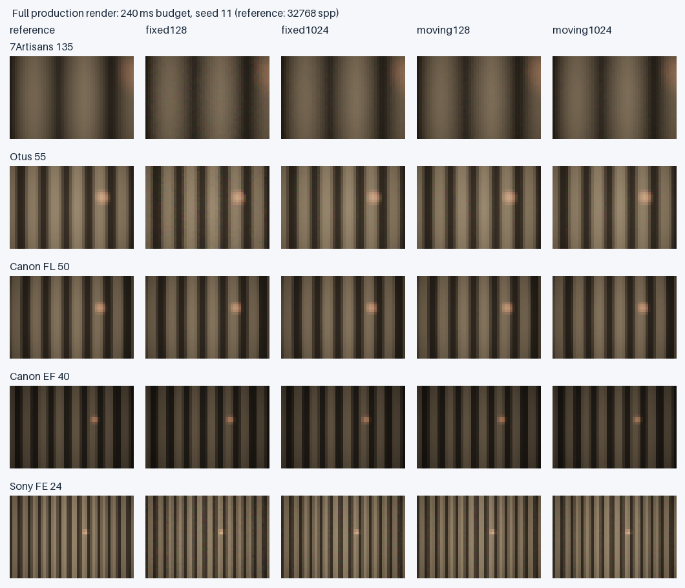

# 分区密度与移动中心实验（2026-10-16）

比较固定矩形和随实际像高移动中心的矩形，各128/256/512/1024分区。色散、镜头处方、实际像面、最大光圈、5%全域混合、完整PDF和正式追迹均相同。当前默认仍为固定128；实验选项通过engine optics state的pupilBins/pupilMovingCenter设置。

移动方案只线性插值中心，在移动坐标内保留能包住两端及中点的固定相对矩形，不插值缩小宽高。CPU和GPU均按真实传感器采样点（包括像素抖动）查同一个条件PDF，平移本身无额外Jacobian。

## 设置与验证

- 代码：c232f7d；渲染试验顺序/末段预算/参考计时修正9fa6845；采样算法在这两版相同。
- 主测试Safari Technology Preview Version/27.0，Apple adapter，uniform上限65536 bytes；新表32784 bytes，硬件timestamp可用。GPU API errors/losses为空，最终通过前台与失焦检查的运行才采纳。
- 五个镜头均为配置0、36×24mm、资料给定sensorZMm，7Artisans/Otus/Sony最后顶点到像面均为1mm；不使用近轴自动对焦像面。
- 固定光线：三个像高比例0/.499/.995，390/550/770nm，三个seed11/29/47，65536次尝试；每方案27组，独立预热排除。
- CPU：五个独立像高比例0/.231/.499/.773/.995，三波长，16384次尝试；192²旧大框积分加96²全域额外检查。8方案共600条记录，在这些有限探测中均未发现框外有效点；这不是全域覆盖证明。
- 72个CPU/GPU采样映射验证通过，最大点坐标差约2e-6mm、相对PDF差约2.74e-7。
- 本轮对中点也做完整独立边界搜索，固定/移动共用同一批2N+1物理节点，因此新128的冷建时间不能直接当作上一版仅检查区间外沿的128成本。

## 通过率（Safari固定光线，27组均值）

| 镜头 | 固定128 | 固定256 | 固定512 | 固定1024 | 移动128 | 移动256 | 移动512 | 移动1024 |
|---|---:|---:|---:|---:|---:|---:|---:|---:|
| 7Artisans 135/1.8 | 45.10% | 52.26% | 56.94% | 59.59% | 62.29% | 62.32% | 62.46% | 62.45% |
| Otus 55/1.4 | 50.03% | 56.83% | 61.13% | 63.51% | 65.94% | 66.02% | 66.10% | 66.09% |
| Canon FL 50/1.8 | 69.18% | 69.24% | 69.45% | 69.41% | 69.26% | 69.26% | 69.46% | 69.40% |
| Canon EF 40/2.8 | 69.37% | 69.46% | 69.65% | 69.68% | 69.45% | 69.48% | 69.67% | 69.68% |
| Sony FE 24/1.4 | 51.18% | 57.19% | 60.86% | 62.76% | 64.71% | 64.75% | 64.82% | 64.76% |

## 冷预计算与缓存转换

以下秒数为物理节点搜索+表布局生成。固定/移动复用相同物理节点；第一次fixed后切换到moving的实际调用仅为转换，不代表moving能在没有预计算时瞬间冷建。单独列出转换毫秒数；新分区数需要新的物理探测，不能忽略其成本。

| 镜头 | 128冷建s | 256冷建s | 512冷建s | 1024冷建s | 移动128缓存转换ms |
|---|---:|---:|---:|---:|---:|
| 7Artisans 135/1.8 | 2.773 | 5.499 | 10.880 | 21.914 | 0.000 |
| Otus 55/1.4 | 2.294 | 4.363 | 8.468 | 16.737 | 0.000 |
| Canon FL 50/1.8 | 0.750 | 1.399 | 2.689 | 5.376 | 0.000 |
| Canon EF 40/2.8 | 0.871 | 1.679 | 3.179 | 6.166 | 0.000 |
| Sony FE 24/1.4 | 3.084 | 5.905 | 11.656 | 22.826 | 0.000 |

固定光线shader/pipeline编译226.0ms，单独于表构建与正式dispatch计时。GPU timestamp与queue/readback墙钟全部保存在[Safari原始报告](pupil-resolution-native-safari.json)中；Apple部分timestamp与墙钟有明显差异，不把这类短dispatch差别解释为精确整帧加速。[CPU原始报告](pupil-resolution-native-cpu.json)。

## 真实场景：等渲染时间下的图像误差

生产BVH、材料发光、完整镜头、光谱采样，48×32图像；32条真实发光几何条纹与有限离焦点光源。80/240ms queue-complete渲染墙钟预算，每方案四个seed，正反顺序平衡；末段自适应缩小提交批次。预计算、预热、reset、回读和resolve排除，保留实际renderMs。以两份独立16384spp图像平均作为32768spp参考；第三份固定128的16384spp图像检查能量与形态一致性。参考本身存在噪声，报告保留referenceNoiseMSE。

以下每镜头均用240ms预算的四seed均值。MSE越小越好，时间×MSE效率比用实际renderMs修正预算超时；小于几个百分点的差异应结合种子波动及参考噪声解读。该实验是一个场景/分辨率的实测，不保证任意场景同倍数。

### 7Artisans 135/1.8

| 方案 | 实际ms | 平均spp | 相对RMSE | MSE/固定128 | 时间×MSE效率倍数 |
|---|---:|---:|---:|---:|---:|
| fixed128 | 241.50 | 2150 | 5.178% | 1.000 | 1.000× |
| fixed256 | 241.25 | 2199 | 3.958% | 0.585 | 1.712× |
| fixed512 | 240.75 | 2144 | 3.025% | 0.341 | 2.940× |
| fixed1024 | 240.75 | 2135 | 2.718% | 0.276 | 3.635× |
| moving128 | 240.75 | 2136 | 2.489% | 0.231 | 4.335× |
| moving256 | 240.75 | 2172 | 2.499% | 0.233 | 4.305× |
| moving512 | 241.50 | 2140 | 2.521% | 0.237 | 4.214× |
| moving1024 | 240.50 | 2147 | 2.533% | 0.239 | 4.194× |

独立高采样固定128/移动1024平均亮度比：0.999832；参考噪声MSE占固定128本轮MSE约0.79%。

### Otus 55/1.4

| 方案 | 实际ms | 平均spp | 相对RMSE | MSE/固定128 | 时间×MSE效率倍数 |
|---|---:|---:|---:|---:|---:|
| fixed128 | 241.50 | 1445 | 5.519% | 1.000 | 1.000× |
| fixed256 | 240.75 | 1626 | 4.148% | 0.565 | 1.777× |
| fixed512 | 240.25 | 1741 | 3.415% | 0.383 | 2.628× |
| fixed1024 | 242.00 | 1852 | 3.125% | 0.321 | 3.109× |
| moving128 | 240.25 | 1856 | 2.982% | 0.292 | 3.441× |
| moving256 | 241.00 | 1860 | 2.998% | 0.295 | 3.393× |
| moving512 | 240.25 | 1855 | 2.992% | 0.294 | 3.421× |
| moving1024 | 240.75 | 1848 | 2.984% | 0.293 | 3.429× |

独立高采样固定128/移动1024平均亮度比：0.999919；参考噪声MSE占固定128本轮MSE约0.55%。

### Canon FL 50/1.8

| 方案 | 实际ms | 平均spp | 相对RMSE | MSE/固定128 | 时间×MSE效率倍数 |
|---|---:|---:|---:|---:|---:|
| fixed128 | 240.75 | 3668 | 1.559% | 1.000 | 1.000× |
| fixed256 | 240.50 | 3664 | 1.551% | 0.991 | 1.010× |
| fixed512 | 240.50 | 3652 | 1.535% | 0.970 | 1.032× |
| fixed1024 | 240.50 | 3636 | 1.500% | 0.926 | 1.081× |
| moving128 | 240.50 | 3644 | 1.538% | 0.974 | 1.028× |
| moving256 | 240.00 | 3668 | 1.530% | 0.964 | 1.041× |
| moving512 | 240.75 | 3664 | 1.531% | 0.965 | 1.036× |
| moving1024 | 240.50 | 3648 | 1.518% | 0.950 | 1.054× |

独立高采样固定128/移动1024平均亮度比：0.999907；参考噪声MSE占固定128本轮MSE约6.96%。

### Canon EF 40/2.8

| 方案 | 实际ms | 平均spp | 相对RMSE | MSE/固定128 | 时间×MSE效率倍数 |
|---|---:|---:|---:|---:|---:|
| fixed128 | 241.75 | 2669 | 1.707% | 1.000 | 1.000× |
| fixed256 | 241.25 | 2654 | 1.678% | 0.965 | 1.037× |
| fixed512 | 240.50 | 2659 | 1.685% | 0.974 | 1.032× |
| fixed1024 | 240.75 | 2665 | 1.681% | 0.969 | 1.036× |
| moving128 | 241.00 | 2660 | 1.691% | 0.981 | 1.022× |
| moving256 | 241.25 | 2653 | 1.710% | 1.005 | 0.996× |
| moving512 | 240.25 | 2662 | 1.679% | 0.967 | 1.040× |
| moving1024 | 241.75 | 2648 | 1.665% | 0.950 | 1.051× |

独立高采样固定128/移动1024平均亮度比：0.999967；参考噪声MSE占固定128本轮MSE约4.79%。

### Sony FE 24/1.4

| 方案 | 实际ms | 平均spp | 相对RMSE | MSE/固定128 | 时间×MSE效率倍数 |
|---|---:|---:|---:|---:|---:|
| fixed128 | 240.75 | 1223 | 5.419% | 1.000 | 1.000× |
| fixed256 | 241.25 | 1261 | 4.002% | 0.546 | 1.828× |
| fixed512 | 241.00 | 1282 | 3.654% | 0.455 | 2.198× |
| fixed1024 | 240.00 | 1274 | 3.524% | 0.423 | 2.370× |
| moving128 | 241.00 | 1262 | 3.336% | 0.379 | 2.635× |
| moving256 | 240.75 | 1276 | 3.307% | 0.372 | 2.685× |
| moving512 | 240.75 | 1270 | 3.306% | 0.372 | 2.687× |
| moving1024 | 240.50 | 1279 | 3.286% | 0.368 | 2.722× |

独立高采样固定128/移动1024平均亮度比：1.000012；参考噪声MSE占固定128本轮MSE约0.37%。

生产积分器/缓冲区初始化1496.0ms，完整场景初始化1653.0ms，均排除在正式渲染预算之外。[真实渲染原始报告](pupil-resolution-native-render.json)。

预览为reference、fixed128、fixed1024、moving128、moving1024，240ms预算、seed11。统计误差在线性RGB上计算；缩略图仅用于观察。

## 判断与跨硬件复核

**优先选移动中心128；不建议统一升到512或1024。**

- 固定矩形加密确实有效：7Artisans从45.10%→52.26%→56.94%→59.59%，240ms图像MSE随之降低。但移动128已达到62.29%，图像误差也低于固定1024，冷建约2.77s而非21.91s。
- 三个小出瞳镜头，移动128相对固定128在Safari上的实际时间×MSE效率倍数约4.33/3.44/2.64，RTX4090上原始同预算MSE倍数约4.36/4.53/2.76。倍数依赖硬件、场景、分辨率和积分时长，不是FPS倍数。
- 移动128→1024的通过率仅增加约0.05–0.16个百分点（7Artisans/Otus/Sony），实际图像误差并未稳定改善；1024的冷建约为128的8倍。个别种子/镜头的几个百分点差别不足以抵偿新增成本。
- 两支Canon的128方案已较紧，移动中心或增加分区在此实验中没有稳定的跨硬件画质收益；不应承诺所有镜头都改善。
- 当前应用默认仍保留固定128，实验代码已支持通过state启用移动中心。此报告给出推荐，不把实验默认切换当作已完成的全目录验证。

[Windows完整汇总](pupil-resolution-windows-summary.md)记录8方案的通过率、冷建、GPUms及真实图像MSE；该会话原始报告保留在Windows独立工作树。无额外上传授权请求或重复推送尝试。

Safari正式渲染实际预算范围：80ms轮为80–88ms，240ms轮为240–247ms，表中的时间×MSE效率使用每行实际耗时。高采样固定128与移动1024参考的平均亮度差最大约0.017%。参考噪声占240ms基线MSE约0.5%–7%，因此不把普通镜头的几个百分点变化视作稳定收益。这里没有测量完整桌面应用的显示帧率，也不以缩略图肉眼差别代替线性RGB误差。

Sony的WGSL求交数值失败仍作为零贡献保留，GPU API错误与设备丢失单独记录、均为空。所有有限覆盖检查依然无法证明未测波长/像高或独立通路不存在，因此本轮全部保留5%全域混合。各分区数按独立冷建测量；当前仅在同分区的固定/移动表示之间复用物理节点，没有把跨分区升档时共享节点的潜在缓存收益算进冷建表。

最终验收：`npm test` 156/156，`npm run build` 通过，`git diff --check` 通过。两台机器的测试服务与本次测试浏览器/标签页已清理，原有标签页与工作区保留。时间×MSE倍数仅描述所测预算点，不等同于达到相同误差所需时间的精确倍数，Sobol收敛也不必严格按1/t。
